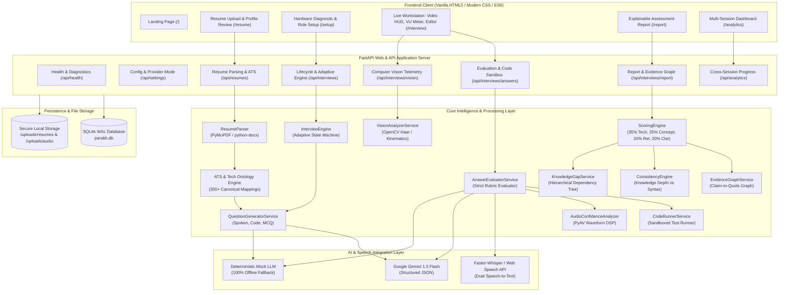
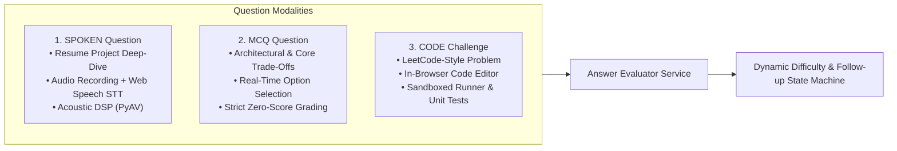
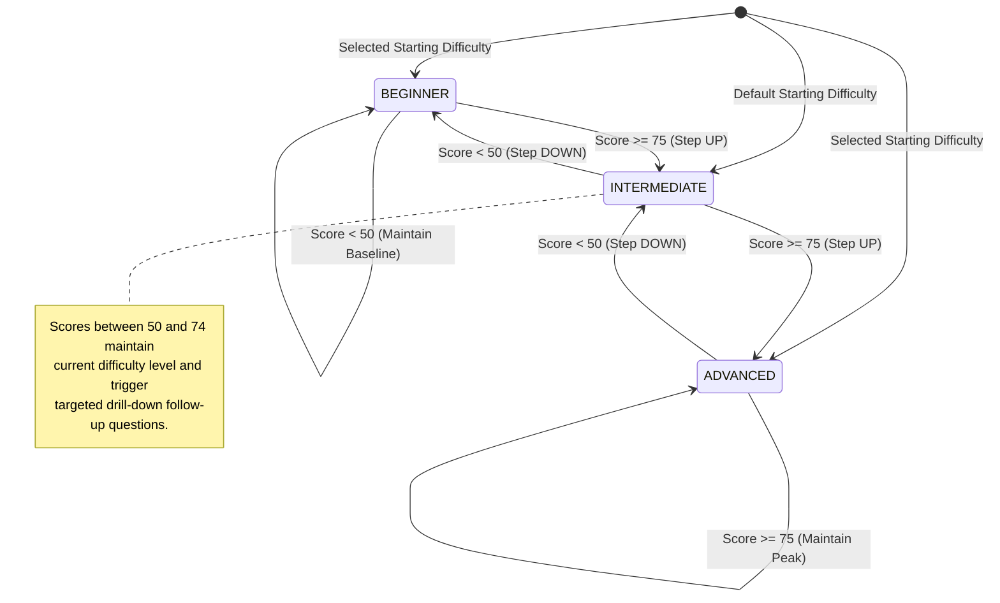
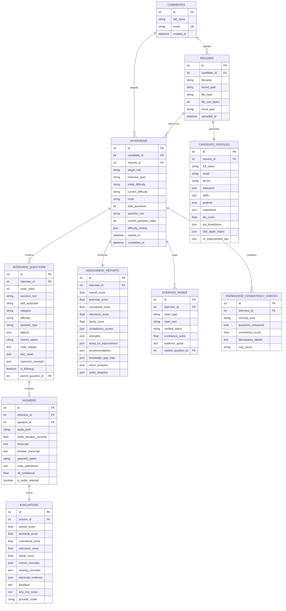

# PARAKH (Performance and Resume Analysis for Knowledge and Hiring)

[](https://www.python.org/)
[](https://fastapi.tiangolo.com/)
[](https://opencv.org/)
[](https://pyav.org/)
[](https://sqlite.org/)
[](https://ai.google.dev/)
[-success?style=flat-square&logo=pytest&logoColor=white)](https://docs.pytest.org/)
[](https://developer.mozilla.org/en-US/docs/Web/JavaScript)

> **PARAKH** is an enterprise-grade, multi-modal, AI-driven candidate assessment and mock interview intelligence platform. Unlike conventional quiz platforms or static keyword matchers, PARAKH grounds every technical question directly in the candidate's verified resume projects, analyzes spoken technical answers in real time, executes and grades live coding challenges in a sandboxed runtime, monitors physical composure and vocal fluency with computer vision and acoustic signal processing, dynamically adapts question difficulty on the fly, and produces explainable, transparent assessment reports backed by an interactive Evidence Graph.

---

## Table of Contents

1. [Project Vision & Overview](#1-project-vision--overview)
2. [Architectural Philosophy](#2-architectural-philosophy)
3. [System Architecture](#3-system-architecture)
4. [Core Features & Engineering Deep Dive](#4-core-features--engineering-deep-dive)
   - [4.1 Resume Ingestion & 0–100 ATS Compatibility Engine](#41-resume-ingestion--0100-ats-compatibility-engine)
   - [4.2 300+ Technology Ontology & Canonical Alias Mapping](#42-300-technology-ontology--canonical-alias-mapping)
   - [4.3 Multi-Modal Interview Workstation (Spoken, Code, MCQ)](#43-multi-modal-interview-workstation-spoken-code-mcq)
   - [4.4 Dynamic Adaptive Engine & Real-Time Branching](#44-dynamic-adaptive-engine--real-time-branching)
   - [4.5 Acoustic Signal Processing Engine (PyAV)](#45-acoustic-signal-processing-engine-pyav)
   - [4.6 Computer Vision Proctoring & Posture Kinematics (OpenCV)](#46-computer-vision-proctoring--posture-kinematics-opencv)
   - [4.7 Explainable Scoring & Resume-to-Evidence Intelligence Graph](#47-explainable-scoring--resume-to-evidence-intelligence-graph)
   - [4.8 Knowledge Consistency Engine & Gap Hierarchy](#48-knowledge-consistency-engine--gap-hierarchy)
   - [4.9 Multi-Session Candidate Improvement Analytics](#49-multi-session-candidate-improvement-analytics)
5. [Database Schema & Data Model](#5-database-schema--data-model)
6. [Complete RESTful API Reference](#6-complete-restful-api-reference)
7. [Repository Structure](#7-repository-structure)
8. [Environment Configuration Reference](#8-environment-configuration-reference)
9. [Installation & Setup Instructions](#9-installation--setup-instructions)
10. [Running the Application](#10-starting-the-application)
11. [Automated Test Suite & Verification](#11-automated-test-suite--verification)
12. [Candidate Journey & UI Walkthrough](#12-candidate-journey--ui-walkthrough)
13. [Security, Privacy & Ethical Guardrails](#13-security-privacy--ethical-guardrails)
14. [Troubleshooting & Common FAQs](#14-troubleshooting--common-faqs)
15. [Author](#15-author)
16. [License & Acknowledgments](#16-license--acknowledgments)

---

## 1. Project Vision & Overview

Technical interviews and resume screening today suffer from three fundamental flaws:
1. **Passive Resume Exaggeration**: Resumes list buzzwords, libraries, and frameworks that candidates often cannot substantiate when asked about real architectural constraints.
2. **Generic, Disconnected Questions**: Most interview tools ask memorized trivia or standard algorithmic teasers disconnected from what candidates actually built in their stated projects.
3. **Black-Box, Opaque Scoring**: Automated assessment tools assign arbitrary percentage scores without explaining *why* a candidate scored high or low, lacking transcript citations or concrete improvement roadmaps.

### The PARAKH Solution

PARAKH (*Hindi for "Appraisal" or "Examination"*) solves this through a multi-modal, evidence-driven pipeline:
- **Resume-Grounded Inquiry**: Dynamically extracts project architectures (e.g. *Microservices*, *Event-Driven*, *Serverless*) and quantified performance metrics (e.g. *"reduced latency by 35%"*, *"processed 10k RPS"*) to challenge candidates on real engineering trade-offs.
- **Tri-Modal Assessment**:
  - `SPOKEN`: Natural spoken technical answers analyzed via streaming speech-to-text, dual-layer verification, and acoustic signal processing.
  - `CODE`: Practical LeetCode-style debugging and implementation challenges executed against dynamic test suites in a sandboxed Python runner.
  - `MCQ`: Conceptual multi-choice questions with strict negative verification (zero points awarded for guesses, unselected options, or admitted uncertainty).
- **Dual-Sensor Composure Telemetry**:
  - **Acoustic Waveforms**: Analyzes pitch jitter, vocal tremor, speech fluency ratio, and contiguous hesitations (>1.5s) using PyAV.
  - **Computer Vision**: Non-intrusive local OpenCV analysis measuring eye contact stability, upper-body posture kinematics (slouching, lateral leaning, fidgeting), head pose (yaw/pitch), and multi-face anti-cheating alerts.
- **Dynamic Difficulty Adaptation**: Real-time state machine stepping up ($\ge 75$) or down ($< 50$) and inserting dynamic follow-up drill-downs when candidate answers are borderline.
- **Explainable Evidence Graph**: Maps resume claims to questions, candidate quotes, and verification states (`VERIFIED`, `PARTIALLY_DEMONSTRATED`, `UNVERIFIED`, `CONTRADICTORY`).

---

## 2. Architectural Philosophy

PARAKH is engineered around strict architectural principles:

- **Strict Zero-JS-Framework Frontend**: Built with pure, standard-compliant Vanilla HTML5, CSS3 Variables, and native ES6 JavaScript Modules. No React, Vue, Angular, TypeScript, Node.js runtime, webpack, or npm build steps. The frontend runs directly in any modern evergreen browser with zero client compilation.
- **Dual AI Provider Architecture**: Seamlessly toggles between the **Google Gemini Free Tier** (via official `google-genai` SDK and structured JSON output) and a deterministic **Mock LLM Provider**. The entire application, test suite, and UI work 100% offline without needing an API key or internet access.
- **Resilient Persistence**: SQLite engine configured with **Write-Ahead Logging (WAL)**, `PRAGMA foreign_keys = ON`, `busy_timeout = 5000ms`, and high-concurrency support, eliminating lock contention.
- **Privacy by Design**: Biometric video and audio frames are processed locally or transiently buffered in memory. Audio files are discarded post-transcription unless persistent retention is explicitly enabled. Camera telemetry is never used for hiring disqualification—only for candidate self-composure coaching.

---

## 3. System Architecture

The following diagram illustrates the end-to-end data flow and service interactions within PARAKH:



---

## 4. Core Features & Engineering Deep Dive

### 4.1 Resume Ingestion & 0–100 ATS Compatibility Engine

PARAKH natively extracts text and structural metadata from PDF files using `PyMuPDF` (`fitz`) and Word documents using `python-docx`. It executes a rigorous, multi-factor ATS parsing algorithm:

- **Section Segmentation**: Regex heuristic boundary scanner partitioning content into `CONTACT`, `EDUCATION`, `SKILLS`, `EXPERIENCE`, `PROJECTS`, and `CERTIFICATIONS`.
- **ATS Compatibility Score (0–100)**: Transparently computed across five deterministic dimensions:
  $$\text{ATS Score} = S_{\text{Contact}} (15) + S_{\text{Section}} (25) + S_{\text{Metrics}} (20) + S_{\text{Skills}} (20) + S_{\text{Readability}} (20)$$

| Scoring Dimension | Max Points | Evaluation Criteria & Checks |
|:---|:---:|:---|
| **Contact Completeness** | 15 | Email address (5), phone number (4), LinkedIn URL (3), GitHub/Portfolio (3). |
| **Section Completeness** | 25 | Skills header (7), Projects section (8), Experience (5), Education (5). |
| **Quantifiable Metrics** | 20 | Regular expression detection of latency (ms/s), percentages (%), RPS, scale (users, QPS, records). |
| **Skill Breadth & Stack** | 20 | Multi-category diversity: Languages (5), Frameworks (5), Databases (5), Cloud/DevOps (5). |
| **Readability & Action Verbs** | 20 | Word count thresholds ($>180$ words), bullet density, and verified action verbs (*architected, scaled, optimized, deployed*). |

---

### 4.2 300+ Technology Ontology & Canonical Alias Mapping

To prevent keyword mismatches, the `ResumeAnalyzer` includes a curated 300+ technology ontology that normalizes aliases and slang to canonical industry standards:

```python
# Example Canonical Mapping Snippet
"javascript": {"canonical": "JavaScript", "category": "languages", "aliases": ["js", "es6", "ecmascript"]},
"kubernetes": {"canonical": "Kubernetes", "category": "cloud_and_devops", "aliases": ["k8s", "container-orchestration"]},
"postgresql": {"canonical": "PostgreSQL", "category": "databases_and_tools", "aliases": ["postgres", "pgsql"]},
"fastapi":    {"canonical": "FastAPI",    "category": "frameworks", "aliases": ["fast-api"]},
"kafka":      {"canonical": "Apache Kafka", "category": "architecture", "aliases": ["kafka", "event-streaming"]}
```

The system categorizes skills into five functional domains:
1. `languages` (Python, Go, Rust, Java, TypeScript, C++, etc.)
2. `frameworks` (FastAPI, React, Django, Spring Boot, PyTorch, etc.)
3. `databases_and_tools` (PostgreSQL, Redis, Elasticsearch, DynamoDB, MongoDB, etc.)
4. `cloud_and_devops` (Docker, Kubernetes, AWS, Terraform, GitHub Actions, Linux, etc.)
5. `architecture` (Microservices, Event-Driven Architecture, REST APIs, GraphQL, gRPC, etc.)

---

### 4.3 Multi-Modal Interview Workstation (Spoken, Code, MCQ)

PARAKH delivers a unified interview workstation supporting three question formats:



1. **`SPOKEN` Technical Questions**:
   - The platform presents a prompt grounded in candidate projects.
   - Dual-layer transcription: Live zero-latency streaming via browser **Web Speech API** paired with an editable confirmation box, backed by server-side `faster-whisper`.
   - Audio is validated via `PyAV` for acoustic clarity and vocal tremor.

2. **`MCQ` Conceptual Questions**:
   - Questions feature randomized option sets ($A, B, C, D$) testing system architecture trade-offs.
   - Strict scoring guarantees: Unselected options, wrong choices, or candidate verbal admissions of ignorance (e.g., *"I don't know"*, *"not sure"*) receive **strictly 0.0 points**.

3. **`CODE` Interactive Programming Challenges**:
   - In-browser editor pre-loaded with starter boilerplate and comments.
   - **Sandboxed Test Runner (`CodeRunnerService`)**: Executes candidate Python code against test suites in an isolated subprocess with strict execution timeouts ($3.5\text{s}$) and memory limits.
   - **Automated Defect & Anti-Cheating Synthesis**:
     - *Unmodified Boilerplate Check*: Detects if starter template was submitted without changes.
     - *Async Blocking Check*: Verifies if candidates mistakenly used `time.sleep` instead of `await asyncio.sleep` in asynchronous concurrency tasks.
     - *Pass / Empty Body Check*: Flags functions containing only `pass` without algorithmic logic.

---

### 4.4 Dynamic Adaptive Engine & Real-Time Branching

The interview difficulty does not follow a static linear script; it adapts to the candidate's immediate performance after every single question:



- **Dynamic Follow-Up Branching**: If a candidate provides a borderline or ambiguous answer ($50 \le \text{Score} \le 75$), `QuestionGeneratorService` automatically generates a contextual follow-up question referencing the candidate's exact transcript claims.

---

### 4.5 Acoustic Signal Processing Engine (PyAV)

PARAKH inspects raw audio waveforms independently of speech-to-text transcripts using `PyAV` and `numpy`:

```
Raw Audio (.webm / .wav) ──► PyAV Frame Extraction ──► Downmix to Mono [-1.0, 1.0]
                                                              │
    ┌─────────────────────────┬───────────────────────────────┴──────────────────────────────┐
    ▼                         ▼                                                              ▼
Windowed RMS Energy       Voice Activity Detection (VAD)                             Pitch (F0) Modulation
(50ms Window / 25ms Hop)  Hesitation Detector (Pauses > 1.5s)                        Autocorrelation Peak (75-400Hz)
    │                         │                                                              │
    └─────────────────────────┼──────────────────────────────────────────────────────────────┘
                              ▼
           Acoustic Vocal Confidence Index (0 to 100)
           • Fluency Ratio %       • Pitch Jitter %
           • Average RMS dB        • Vocal Tremor Classification
```

- **Hesitation Quantization**: Detects contiguous silence windows exceeding $1.5\text{ seconds}$ to measure conceptual hesitation.
- **Pitch Jitter & Vocal Tremor**: Measures fundamental frequency variations across speech frames to gauge vocal composure under pressure.

---

### 4.6 Computer Vision Proctoring & Posture Kinematics (OpenCV)

Operating completely client-side or via discrete frame sampling, `VisionAnalyzerService` analyzes candidate video feeds with OpenCV:

- **Multi-Scale Face Localization**: Detects faces using dual Haar Cascades (`haarcascade_frontalface_default.xml` and `haarcascade_frontalface_alt2.xml`).
- **Anti-Cheating Multi-Face Detection**: Flags frame intervals containing multiple individuals in the camera field of view.
- **Biometric Identity Continuity**: Computes HSV color histograms of the candidate's face region on initial setup and verifies histogram correlation across frames ($\ge 0.40$), identifying if another individual swaps into the seat.
- **Ocular Feature Tracking & Eye Contact Stability**: Tracks bilateral ocular features (`haarcascade_eye.xml` / `haarcascade_eye_tree_eyeglasses.xml`) to calculate direct eye contact ratio over time.
- **Upper-Body Posture Kinematics**: Computes face centroid movement velocity to detect restlessness, fidgeting, slouching, and lateral head tilt angles.

---

### 4.7 Explainable Scoring & Resume-to-Evidence Intelligence Graph

PARAKH replaces opaque grading with transparent, explainable scoring cards.

#### Score Weighting Distribution:
$$\text{Overall Score} = (0.35 \times \text{Technical}) + (0.25 \times \text{Conceptual}) + (0.20 \times \text{Relevance}) + (0.20 \times \text{Clarity})$$

Every evaluation card explicitly exposes:
1. **Expected Concepts**: Mandatory architectural requirements for the question.
2. **Missing Concepts**: Specific keywords or trade-offs omitted by the candidate.
3. **Transcript Evidence**: Exact verbatim citation quotes from the candidate's answer.
4. **Why This Score**: Natural-language rationale detailing why points were awarded or deducted.

#### Resume-to-Evidence Intelligence Graph

The platform constructs an interactive directed graph linking claims to empirical interview evidence:

```
[Resume Claim: "Optimized PostgreSQL Query Performance"]
       │
       ▼ (Question: "Explain how you used EXPLAIN ANALYZE and B-Tree indexes")
[Candidate Answer: "We added compound indexes on tenant_id and created_at..."]
       │
       ▼ (Empirical Verification)
[Evidence Node: VERIFIED | Confidence: 92% | Quote: "added compound indexes on tenant_id..."]
```

Nodes are categorized into four verification states:
- `VERIFIED`: Confirmed with strong technical depth and precise project citations.
- `PARTIALLY_DEMONSTRATED`: Foundational familiarity shown, but lacking operational edge-case mastery.
- `UNVERIFIED`: Claim was not sufficiently addressed during the session.
- `CONTRADICTORY`: Candidate gave incorrect or invalid explanations contradicting their resume claim.

---

### 4.8 Knowledge Consistency Engine & Gap Hierarchy

- **Knowledge Consistency Engine (`ConsistencyEngine`)**: Evaluates candidate answers across related questions to detect syntax memorization versus genuine conceptual mastery (e.g. knowing ORM syntax but failing to explain underlying connection pooling or query planning).
- **Hierarchical Knowledge-Gap Map (`KnowledgeGapService`)**: Groups deficiencies into three distinct tiers:
  - `Foundational`: Core language semantics, data structures, and syntax prerequisites.
  - `Intermediate`: API design, database indexing, caching strategies, and unit testing.
  - `Advanced`: Distributed systems, concurrency deadlocks, high-availability consensus, and horizontal scaling.

---

### 4.9 Multi-Session Candidate Improvement Analytics

The `/analytics` portal provides candidates and hiring teams with longitudinal tracking:
- **SVG Score Trajectories**: Interactive vector charts plotting overall, technical, and conceptual score curves over chronological interview attempts.
- **Skill Mastery Delta Table**: Tracks skill gains between baseline and latest attempts (e.g., *FastAPI: $65\% \to 88\%$ ($+23\%$)*).
- **Concept Reinforcement Tracking**: Identifies recurring misconceptions resolved across consecutive sessions.

---

## 5. Database Schema & Data Model

PARAKH utilizes SQLite with Write-Ahead Logging (`WAL`). The schema consists of 9 relational tables:



---

## 6. Complete RESTful API Reference

Interactive OpenAPI documentation is automatically served at `/docs` (Swagger UI) and `/redoc` (ReDoc) when the server is running.

### 6.1 System Diagnostics & Settings
| Method | Endpoint | Description |
|:---|:---|:---|
| `GET` | `/api/health/live` | Liveness probe returning server uptime and timestamp. |
| `GET` | `/api/health/ready` | Readiness probe checking database connectivity and LLM provider readiness. |
| `GET` | `/api/settings/public` | Returns runtime configuration (active LLM provider, mock mode flag, STT model). |

### 6.2 Resumes & Profiles
| Method | Endpoint | Payload / Params | Description |
|:---|:---|:---|:---|
| `POST` | `/api/resumes/upload` | `multipart/form-data` (`file`) | Ingests PDF/DOCX, computes SHA-256, parses text, and returns ATS score + skills profile. |
| `GET` | `/api/resumes/{id}/profile` | `id` (int) | Fetches the structured candidate profile, ATS breakdown, and extracted projects. |
| `PATCH` | `/api/resumes/{id}/profile` | `CandidateProfileUpdate` JSON | Allows candidates to correct contact info, add skills, or update project titles before starting. |

### 6.3 Interview Lifecycle
| Method | Endpoint | Payload / Params | Description |
|:---|:---|:---|:---|
| `POST` | `/api/interviews` | `InterviewCreateRequest` JSON | Creates an interview session, generates role-tailored questions (`SPOKEN`, `CODE`, `MCQ`). |
| `GET` | `/api/interviews` | — | Lists all interviews sorted by creation date descending. |
| `GET` | `/api/interviews/{id}` | `id` (int) | Returns interview session metadata, questions, and difficulty history. |
| `POST` | `/api/interviews/{id}/start` | `id` (int) | Transitions state from `READY` to `IN_PROGRESS`, sets start timestamp. |
| `GET` | `/api/interviews/{id}/current-question` | `id` (int) | Retrieves the current active question matching `current_question_index`. |
| `POST` | `/api/interviews/{id}/end` | `id` (int) | Concludes the interview immediately and triggers report synthesis. |
| `POST` | `/api/interviews/{id}/cancel` | `id` (int) | Cancels the interview session and marks state as `CANCELLED`. |

### 6.4 Spoken Answers, Code Execution & Grading
| Method | Endpoint | Payload / Params | Description |
|:---|:---|:---|:---|
| `POST` | `/api/interviews/{id}/answers/audio` | `multipart/form-data` | Submits spoken answer (audio file and/or browser transcript), selected MCQ option, or code solution. Evaluates score, steps difficulty, and returns evaluation feedback. |
| `POST` | `/api/interviews/{id}/answers/run-code` | `CodeRunRequest` JSON (`code`, `language`) | Runs candidate code against dynamic unit test cases in a sandboxed subprocess and returns runtime stdout/errors. |

### 6.5 Computer Vision Telemetry
| Method | Endpoint | Payload / Params | Description |
|:---|:---|:---|:---|
| `POST` | `/api/interviews/{id}/vision/frame` | `image_base64` or `frame_file` | Analyzes a single camera frame for faces, eye contact, head pose, posture, and facial composure. |
| `GET` | `/api/interviews/{id}/vision/analytics` | `id` (int) | Retrieves aggregate session vision analytics (eye contact ratio, posture score, composure index). |

### 6.6 Assessment Reports & Evidence Graph
| Method | Endpoint | Description |
|:---|:---|:---|
| `GET` | `/api/interviews/{id}/report` | Returns the comprehensive report with overall score, 4-dimension breakdown, competency map, strengths, improvement areas, audio telemetry, and vision analytics. |
| `GET` | `/api/interviews/{id}/evidence-graph` | Returns nodes and edges connecting resume claims to candidate transcript quotes and verification statuses. |
| `GET` | `/api/interviews/{id}/consistency` | Returns cross-question consistency checks detecting conceptual vs. syntax comprehension. |

### 6.7 Multi-Session Analytics
| Method | Endpoint | Payload / Params | Description |
|:---|:---|:---|:---|
| `GET` | `/api/analytics/progress` | `candidate_id` (optional int) | Computes multi-session score trajectory curves, skill mastery deltas, and concept reinforcement. |

---

## 7. Repository Structure

```
PARAKH/
├── backend/
│   ├── app/
│   │   ├── api/
│   │   │   └── routes/
│   │   │       ├── analytics.py          # Cross-session progress & skill mastery deltas
│   │   │       ├── answers.py            # Spoken answer processing, STT, code run sandbox
│   │   │       ├── health.py             # Liveness & readiness probes
│   │   │       ├── interviews.py         # Interview state machine & question progression
│   │   │       ├── reports.py            # Assessment report & evidence graph endpoints
│   │   │       ├── resumes.py            # Resume upload, parsing, ATS scoring & profile edit
│   │   │       ├── settings.py           # Public system settings & provider status
│   │   │       └── vision.py             # OpenCV frame processing & session vision analytics
│   │   ├── core/
│   │   │   ├── config.py                 # Pydantic BaseSettings & directory configuration
│   │   │   ├── exceptions.py             # Custom domain exceptions & HTTP mappings
│   │   │   └── security.py               # File validation, MIME detection, SHA-256 & UUIDs
│   │   ├── db/
│   │   │   └── database.py               # SQLAlchemy engine, session maker & SQLite WAL init
│   │   ├── integrations/
│   │   │   ├── gemini_provider.py        # Google Gemini 1.5 Flash client via google-genai SDK
│   │   │   ├── llm_base.py               # Abstract Base Class for LLM providers
│   │   │   ├── mock_llm_provider.py      # Deterministic 100% offline fallback LLM
│   │   │   └── speech_provider.py        # faster-whisper STT integration with mock fallback
│   │   ├── models/
│   │   │   └── entities.py               # SQLAlchemy models (9 tables & relationships)
│   │   ├── schemas/
│   │   │   ├── analytics.py              # Schemas for progress curves & skill deltas
│   │   │   ├── evaluation.py             # Schemas for assessment reports & evidence nodes
│   │   │   ├── interview.py              # Schemas for interview sessions, questions & code run
│   │   │   └── profile.py                # Schemas for resume profile & ATS scores
│   │   ├── services/
│   │   │   ├── analytics_service.py      # Cross-interview score trends & skill deltas
│   │   │   ├── answer_evaluator.py       # Tri-modal response grading (Spoken, Code, MCQ)
│   │   │   ├── audio_confidence_analyzer.py # PyAV acoustic DSP (RMS, VAD, pitch jitter)
│   │   │   ├── code_runner.py            # Sandboxed Python code execution & test synthesis
│   │   │   ├── consistency_engine.py     # Cross-domain conceptual consistency checks
│   │   │   ├── evidence_graph_service.py # Graph mapper for resume claims to interview evidence
│   │   │   ├── interview_engine.py       # Dynamic single-question difficulty adaptation
│   │   │   ├── knowledge_gap_service.py  # Hierarchical 3-tier gap hierarchy builder
│   │   │   ├── question_generator.py     # Role & resume grounded question generator
│   │   │   ├── resume_analyzer.py        # 300+ ontology, ATS scoring & project metrics parser
│   │   │   ├── resume_parser.py          # PyMuPDF & python-docx raw document text extraction
│   │   │   ├── scoring_engine.py         # Multi-dimension final report synthesizer
│   │   │   └── vision_analyzer.py        # OpenCV face, eye, posture & composure telemetry
│   │   └── main.py                       # FastAPI application entry point, routes & static mounts
│   └── tests/
│       ├── conftest.py                   # Pytest fixtures & in-memory test database setup
│       ├── test_adaptive_engine.py       # Difficulty step-up, step-down & boundary clamp tests
│       ├── test_analytics_engine.py      # Progress trajectories & skill delta tests
│       ├── test_api_endpoints.py         # Complete end-to-end candidate workflow test
│       ├── test_cv_audio_adaptive_engine.py # Synthetic audio DSP, vision frames & dynamic questions
│       ├── test_evidence_graph.py        # Evidence graph sync & claim verification tests
│       ├── test_heavy_cv_analyzer.py     # Resume parser, contact extraction & ATS score tests
│       ├── test_jpmorgan_rigorous_qa.py  # Audio silence/hesitation, face reentry & MCQ edge cases
│       ├── test_leetcode_and_mcq_grading.py # Code runner, LeetCode attributes & MCQ zero score
│       ├── test_multimodal_interviews.py # Tri-modal question generation & uncertainty grading
│       ├── test_profile_extraction.py    # Raw text analyzer & profile entity extraction
│       ├── test_resume_parser.py         # PDF/DOCX file extraction & invalid format handling
│       └── test_vision_analyzer.py       # OpenCV initialization, frame analysis & report generation
├── frontend/
│   ├── static/
│   │   ├── css/
│   │   │   ├── analytics.css             # Multi-session trajectory & skill delta styles
│   │   │   ├── base.css                  # Design tokens, reset, navbar, buttons & cards
│   │   │   ├── interview.css              # Workstation HUD, split-screen, audio meter & editor
│   │   │   ├── report.css                 # Score gauges, explainable cards & evidence graph
│   │   │   └── variables.css             # Color palette, spacing, typography & theme variables
│   │   └── js/
│   │       ├── analytics.js              # Vector SVG score trajectory charts & delta tables
│   │       ├── api.js                    # Centralized async fetch wrapper & error handling
│   │       ├── audio-recorder.js         # MediaRecorder API, Web Audio VU meter & Web Speech STT
│   │       ├── camera-preview.js         # MediaDevices camera stream & periodic frame capture
│   │       ├── charts.js                 # Lightweight SVG chart generators (gauges & bars)
│   │       ├── dashboard.js              # Candidate interview history & quick stats
│   │       ├── interview.js              # Live interview state machine & question rendering
│   │       ├── report.js                 # Report tabs, evidence graph viewer & PDF print export
│   │       ├── resume.js                 # Drag-and-drop resume upload & profile editor
│   │       └── setup.js                  # Pre-interview hardware verification & role selection
│   └── templates/
│       ├── analytics.html                # Multi-session improvement dashboard page
│       ├── dashboard.html                # Candidate home workspace page
│       ├── index.html                    # Platform landing page & feature overview
│       ├── interview.html                # Live multi-modal interview workstation
│       ├── report.html                   # Detailed assessment report & evidence graph page
│       ├── resume.html                   # Resume upload & ATS diagnostic page
│       └── setup.html                    # Hardware test & session configuration page
├── uploads/                              # Local storage for resumes & ephemeral audio
│   ├── audio/                            # Buffered candidate spoken audio chunks
│   └── resumes/                          # Uploaded candidate PDF & DOCX resumes
├── .env.example                          # Environment variable configuration template
├── requirements.txt                      # Complete Python dependency specification
├── run_parakh.ps1                        # PowerShell one-click runner script for Windows
├── run.py                                # Python direct startup entry point
└── README.md                             # Exhaustive project documentation
```

---

## 8. Environment Configuration Reference

PARAKH is configured via environment variables defined in a `.env` file at the project root.

| Environment Variable | Type | Default Value | Description |
|:---|:---:|:---:|:---|
| `APP_NAME` | `string` | `"PARAKH"` | Platform display title. |
| `APP_ENV` | `string` | `"development"` | Application environment (`development`, `production`, `test`). |
| `DEBUG` | `bool` | `True` | Enables debug logging and hot-reload. |
| `DATABASE_URL` | `string` | `"sqlite:///./parakh.db"` | SQLite database connection string. |
| `MAX_UPLOAD_SIZE_MB` | `int` | `15` | Maximum allowed size in megabytes for resume and audio uploads. |
| `AUDIO_RETENTION_ENABLED` | `bool` | `false` | When `false`, candidate audio recordings are deleted immediately after transcription for candidate privacy. |
| `LLM_PROVIDER` | `string` | `"gemini"` | Active AI provider: `"gemini"` for Google Gemini or `"mock"` for offline development. |
| `GEMINI_API_KEY` | `string` | `""` | Free Google Gemini API Key from Google AI Studio. If blank, system auto-switches to `"mock"` mode. |
| `GEMINI_MODEL` | `string` | `"gemini-1.5-flash"` | Gemini model identifier (supports `gemini-1.5-flash`, `gemini-flash-lite-latest`, etc.). |
| `LLM_TIMEOUT_SECONDS` | `int` | `40` | Request timeout in seconds for LLM inferences. |
| `STT_PROVIDER` | `string` | `"faster-whisper"` | Speech-to-Text provider: `"faster-whisper"` for local transcription or `"mock"` for instant mock responses. |
| `WHISPER_MODEL_SIZE` | `string` | `"tiny"` | Faster-Whisper model size (`tiny`, `base`, `small`). |
| `DIFFICULTY_SATISFACTORY_THRESHOLD` | `float` | `70.0` | Minimum score threshold triggering difficulty step-up ($BEGINNER \to INTERMEDIATE \to ADVANCED$). |
| `DIFFICULTY_UNSATISFACTORY_THRESHOLD` | `float` | `50.0` | Threshold below which difficulty steps down ($ADVANCED \to INTERMEDIATE \to BEGINNER$). |
| `CONFIDENCE_MIN_RELIABLE_THRESHOLD` | `float` | `0.65` | Minimum STT confidence before flagging audio quality degradation in reports. |
| `ENABLE_VISION` | `bool` | `false` | When enabled, webcam frames are analyzed for posture and eye contact during the live interview. |

---

## 9. Installation & Setup Instructions

### 9.1 Prerequisites
- **Operating System**: Windows 10/11, macOS (Apple Silicon or Intel), or Linux (Ubuntu 22.04+ recommended).
- **Python Runtime**: Python 3.11 or higher (verified on Python 3.11, 3.12, 3.13, and 3.14).
- **Audio/Video Hardware**: Microphone and optional webcam.
- **Web Browser**: Any modern evergreen browser (Google Chrome, Microsoft Edge, Mozilla Firefox, Brave, Safari 16+).

---

### 9.2 Step-by-Step Installation

#### Step 1: Clone the Repository & Navigate
```bash
git clone https://github.com/your-username/PARAKH.git
cd PARAKH
```
*(On Windows PowerShell: `cd C:\Users\adity\PycharmProjects\PARAKH`)*

#### Step 2: Create and Activate a Virtual Environment
- **On Windows (PowerShell)**:
  ```powershell
  python -m venv .venv
  .venv\Scripts\Activate.ps1
  ```
  *(If execution policies block scripts, run `Set-ExecutionPolicy -Scope Process -ExecutionPolicy Bypass` first)*
- **On macOS / Linux**:
  ```bash
  python3 -m venv .venv
  source .venv/bin/activate
  ```

#### Step 3: Install Required Dependencies
```bash
pip install --upgrade pip
pip install -r requirements.txt
```

#### Step 4: Configure Environment Variables
Copy `.env.example` to `.env`:
- **Windows (PowerShell)**:
  ```powershell
  Copy-Item .env.example .env
  ```
- **macOS / Linux**:
  ```bash
  cp .env.example .env
  ```

#### Step 5: (Optional) Add Free Google Gemini API Key
1. Go to [Google AI Studio](https://aistudio.google.com/app/apikey).
2. Generate a free API key.
3. Open `.env` and paste your key:
   ```env
   LLM_PROVIDER="gemini"
   GEMINI_API_KEY="AIzaSy..."
   GEMINI_MODEL="gemini-1.5-flash"
   ```
> [!NOTE]
> If `GEMINI_API_KEY` is left blank, PARAKH automatically runs in **Deterministic Offline Mock Mode**. The entire system (ATS analysis, question generation, audio recorder, code runner, adaptive engine, evidence graph, report generator) functions 100% offline without errors.

---

## 10. Starting the Application

You can launch the application through any of the following methods:

### Method A: One-Click PowerShell Script (Windows)
```powershell
.\run_parakh.ps1
```
*This verifies the `.venv`, initializes SQLite tables, and launches Uvicorn with hot-reload enabled.*

### Method B: Python Startup Script
```bash
python run.py
```

### Method C: Direct Uvicorn Command
```bash
uvicorn backend.app.main:app --host 127.0.0.1 --port 8000 --reload
```

Once running, navigate to:
- **Web Application**: [http://127.0.0.1:8000](http://127.0.0.1:8000)
- **Interactive Swagger Docs**: [http://127.0.0.1:8000/docs](http://127.0.0.1:8000/docs)
- **Alternative ReDoc UI**: [http://127.0.0.1:8000/redoc](http://127.0.0.1:8000/redoc)

---

## 11. Automated Test Suite & Verification

PARAKH includes a comprehensive test suite of **58 unit, integration, and stress tests** built with `pytest`. All tests run against an in-memory SQLite database (`sqlite:///:memory:`) and validated mock providers.

### Running All Tests
```powershell
.venv\Scripts\python.exe -m pytest backend/tests -v -W ignore
```
*(On macOS / Linux: `pytest backend/tests -v -W ignore`)*

### Test Suite Execution Output
```
============================= test session starts =============================
platform win32 -- Python 3.14.2, pytest-8.3.4, pluggy-1.6.0
rootdir: C:\Users\adity\PycharmProjects\PARAKH
collected 58 items

backend/tests/test_adaptive_engine.py::test_difficulty_steps_up_on_strong_performance PASSED [  1%]
backend/tests/test_adaptive_engine.py::test_difficulty_steps_down_on_weak_performance PASSED [  3%]
backend/tests/test_adaptive_engine.py::test_difficulty_clamps_at_advanced PASSED [  5%]
backend/tests/test_adaptive_engine.py::test_difficulty_clamps_at_beginner PASSED [  6%]
backend/tests/test_analytics_engine.py::test_analytics_progression_and_deltas PASSED [  8%]
backend/tests/test_api_endpoints.py::test_full_candidate_interview_workflow PASSED [ 10%]
backend/tests/test_cv_audio_adaptive_engine.py::test_audio_analyzer_synthetic_waveform PASSED [ 12%]
backend/tests/test_cv_audio_adaptive_engine.py::test_audio_analyzer_missing_or_corrupt_file PASSED [ 13%]
backend/tests/test_cv_audio_adaptive_engine.py::test_vision_analyzer_face_verification PASSED [ 15%]
backend/tests/test_cv_audio_adaptive_engine.py::test_vision_analyzer_posture_kinematics PASSED [ 17%]
backend/tests/test_cv_audio_adaptive_engine.py::test_vision_report_synthesis PASSED [ 18%]
backend/tests/test_cv_audio_adaptive_engine.py::test_code_evaluation_boilerplate_unchanged PASSED [ 20%]
backend/tests/test_cv_audio_adaptive_engine.py::test_code_evaluation_optimal_attempt PASSED [ 22%]
backend/tests/test_cv_audio_adaptive_engine.py::test_dynamic_question_count_arbitrary PASSED [ 24%]
backend/tests/test_cv_audio_adaptive_engine.py::test_instant_adaptive_difficulty_step_up_and_down PASSED [ 25%]
backend/tests/test_evidence_graph.py::test_evidence_graph_sync PASSED    [ 27%]
backend/tests/test_heavy_cv_analyzer.py::test_resume_parser_contact_and_sections PASSED [ 29%]
backend/tests/test_heavy_cv_analyzer.py::test_resume_analyzer_ats_and_deep_projects PASSED [ 31%]
backend/tests/test_jpmorgan_rigorous_qa.py::test_audio_edge_case_pure_silence PASSED [ 32%]
backend/tests/test_jpmorgan_rigorous_qa.py::test_audio_edge_case_multiple_long_hesitations PASSED [ 34%]
backend/tests/test_jpmorgan_rigorous_qa.py::test_audio_edge_case_ultra_short_sample PASSED [ 36%]
backend/tests/test_jpmorgan_rigorous_qa.py::test_vision_edge_case_garbage_base64 PASSED [ 37%]
backend/tests/test_jpmorgan_rigorous_qa.py::test_vision_edge_case_biometric_face_identity_reentry PASSED [ 39%]
backend/tests/test_jpmorgan_rigorous_qa.py::test_vision_posture_extreme_boundary_conditions PASSED [ 41%]
backend/tests/test_jpmorgan_rigorous_qa.py::test_code_edge_case_whitespace_and_comments_only PASSED [ 43%]
backend/tests/test_jpmorgan_rigorous_qa.py::test_code_verbal_admission_of_uncertainty PASSED [ 44%]
backend/tests/test_jpmorgan_rigorous_qa.py::test_mcq_case_insensitivity_and_spacing PASSED [ 46%]
backend/tests/test_jpmorgan_rigorous_qa.py::test_mcq_guess_with_admission_of_ignorance PASSED [ 48%]
backend/tests/test_jpmorgan_rigorous_qa.py::test_question_mix_modes PASSED [ 50%]
backend/tests/test_jpmorgan_rigorous_qa.py::test_full_workflow_end_to_end_jpmorgan PASSED [ 51%]
backend/tests/test_jpmorgan_rigorous_qa.py::test_mcq_unselected_scores_strictly_zero PASSED [ 53%]
backend/tests/test_jpmorgan_rigorous_qa.py::test_idontknow_spoken_scores_strictly_low PASSED [ 55%]
backend/tests/test_jpmorgan_rigorous_qa.py::test_pyav_monkeypatch_metadata_errors PASSED [ 56%]
backend/tests/test_jpmorgan_rigorous_qa.py::test_cv_spectacles_and_cascade_robustness PASSED [ 58%]
backend/tests/test_leetcode_and_mcq_grading.py::test_wrong_mcq_answer_strictly_scores_zero_mock PASSED [ 60%]
backend/tests/test_leetcode_and_mcq_grading.py::test_unattempted_mcq_scores_zero_mock PASSED [ 62%]
backend/tests/test_leetcode_and_mcq_grading.py::test_wrong_mcq_answer_strictly_scores_zero_gemini PASSED [ 63%]
backend/tests/test_leetcode_and_mcq_grading.py::test_code_questions_include_leetcode_attributes PASSED [ 65%]
backend/tests/test_leetcode_and_mcq_grading.py::test_coding_modes_starter_comments PASSED [ 67%]
backend/tests/test_code_runner_service_execution PASSED [ 68%]
backend/tests/test_unimplemented_dsa_code_strictly_fails PASSED [ 70%]
backend/tests/test_uncorrected_async_blocking_bug_strictly_fails PASSED [ 72%]
backend/tests/test_corrected_async_blocking_bug_passes PASSED [ 74%]
backend/tests/test_empty_test_cases_strictly_fails_on_unedited_template PASSED [ 75%]
backend/tests/test_multimodal_interviews.py::test_mock_llm_multimodal_question_generation PASSED [ 77%]
backend/tests/test_multimodal_interviews.py::test_mock_llm_mcq_evaluation PASSED [ 79%]
backend/tests/test_multimodal_interviews.py::test_mock_llm_code_evaluation PASSED [ 81%]
backend/tests/test_multimodal_interviews.py::test_mock_llm_spoken_uncertainty_evaluation PASSED [ 82%]
backend/tests/test_multimodal_interviews.py::test_mock_llm_mcq_uncertainty_not_awarded_90 PASSED [ 84%]
backend/tests/test_multimodal_interviews.py::test_mock_llm_code_starter_template_not_awarded_90 PASSED [ 86%]
backend/tests/test_multimodal_interviews.py::test_mock_llm_dynamic_consistency_not_hardcoded PASSED [ 87%]
backend/tests/test_profile_extraction.py::test_resume_analyzer_text PASSED [ 89%]
backend/tests/test_resume_parser.py::test_extract_text_from_pdf PASSED   [ 91%]
backend/tests/test_resume_parser.py::test_extract_text_from_docx PASSED  [ 93%]
backend/tests/test_resume_parser.py::test_unsupported_file_extension PASSED [ 94%]
backend/tests/test_vision_analyzer.py::test_vision_analyzer_initialization PASSED [ 96%]
backend/tests/test_vision_analyzer.py::test_vision_analyzer_frame_processing PASSED [ 98%]
backend/tests/test_vision_analyzer.py::test_vision_analyzer_report_generation PASSED [100%]

============================= 58 passed in 17.46s =============================
```

---

## 12. Candidate Journey & UI Walkthrough

```
[1. Landing Page (/)]
        │
        ▼
[2. Resume Upload & ATS (/resume)] ──► Review Skills & Edit Extracted Profile
        │
        ▼
[3. Session Setup (/setup)] ────────► Select Target Role, Question Mix, Check Mic VU & Cam
        │
        ▼
[4. Live Workstation (/interview)] ──► Spoken Deep Dives, LeetCode Editor, MCQ Options
        │
        ▼
[5. Assessment Report (/report)] ───► Explainable Scoring, Evidence Graph & Knowledge Gap Map
        │
        ▼
[6. Candidate Dashboard (/dashboard)] & [Longitudinal Analytics (/analytics)]
```

1. **Landing Page (`/`)**: High-level platform introduction, feature highlights, and direct action triggers.
2. **Resume Upload & ATS Diagnostic (`/resume`)**:
   - Drag-and-drop PDF or Word resume.
   - Immediate ATS score calculation (0–100) with diagnostic checklist.
   - Interactive profile editor allowing candidates to refine skills, contact info, and project summaries.
3. **Interview Setup & Hardware Diagnostic (`/setup`)**:
   - Select target role (*Full Stack Engineer*, *Backend Engineer*, *ML Engineer*, *DevOps*, etc.).
   - Configure question mix (*Mixed*, *Spoken Only*, *Coding & MCQ*).
   - Set starting difficulty (*Beginner*, *Intermediate*, *Advanced*).
   - Test camera video preview and test microphone responsiveness with the live Web Audio VU meter.
4. **Live Interview Workstation (`/interview`)**:
   - **Left Panel**: Hardware HUD with real-time video preview, audio VU level visualizer, and current difficulty tier badge.
   - **Right Panel**: Question container:
     - For `SPOKEN`: Displays the project-grounded prompt, record/stop button, real-time speech confirmation text box, and submit button.
     - For `CODE`: Displays problem constraints, input/output examples, interactive code editor, and **Run Code** test sandbox.
     - For `MCQ`: Displays option pills ($A, B, C, D$) with instant selection feedback.
5. **Explainable Assessment Report (`/report`)**:
   - Overall composite score gauge with 4-dimension radar breakdown.
   - Acoustic waveform metrics: fluency ratio, hesitations count, and pitch jitter.
   - Computer vision summary: eye contact ratio, posture kinematics, and visual composure.
   - Interactive **Resume-to-Evidence Intelligence Graph**.
   - Transparent evaluation cards citing verbatim candidate quotes.
   - One-click print/export to PDF.
6. **Candidate Dashboard (`/dashboard`)**:
   - History of all completed interviews, average scores, and direct links to past reports.
7. **Longitudinal Analytics (`/analytics`)**:
   - Chronological vector SVG progression curves.
   - Baseline vs. Latest skill delta table.
   - Concept reinforcement tracking.

---

## 13. Security, Privacy & Ethical Guardrails

PARAKH adheres to strict ethical standards:

- **Zero Biometric Discrimination**: Camera analysis is purely an informational client HUD for candidate self-awareness and anti-cheating continuity. The system strictly forbids facial emotion analysis or demographic heuristics from disqualifying candidates.
- **Ephemeral Audio Buffering**: Spoken audio is buffered temporarily in `/uploads/audio` only to execute speech-to-text. Once transcribed, audio chunks are immediately purged unless `AUDIO_RETENTION_ENABLED=true` is explicitly set by the administrator.
- **Prompt Injection Defense**: All user-provided strings (resume text, spoken transcripts, submitted code) are wrapped in strict, non-executable delimiter blocks with explicit role isolation to prevent adversarial LLM manipulation.
- **Secure File Ingestion**: Uploads are verified for MIME-type integrity and maximum file size ($15\text{MB}$). Stored files are assigned cryptographic UUIDv4 filenames, preventing path traversal attacks.
- **Sandboxed Execution Safeguards**: Candidate Python code execution is sandboxed with strict execution timeouts ($3.5\text{s}$) and blocked from dangerous OS commands or sockets.

---

## 14. Troubleshooting & Common FAQs

### Q1: The browser microphone or camera fails to activate.
**Resolution**: Ensure that browser permissions are granted for `http://127.0.0.1:8000`. In Chrome or Edge, click the lock icon in the URL bar, set Microphone and Camera to **Allow**, and refresh the page.

### Q2: Can PARAKH run completely offline without an internet connection?
**Resolution**: Yes. Leave `GEMINI_API_KEY=""` in your `.env`. PARAKH will automatically fall back to its **Deterministic Mock LLM Provider**, enabling all features, question flows, code running, and reports to work 100% offline.

### Q3: How do I test with my own Google Gemini API key?
**Resolution**: Obtain a free API key at [Google AI Studio](https://aistudio.google.com/app/apikey), add `GEMINI_API_KEY="your_key"` in `.env`, and ensure `LLM_PROVIDER="gemini"`. Restart the server.

### Q4: I get a `database is locked` error on Windows.
**Resolution**: PARAKH enables SQLite Write-Ahead Logging (`WAL`) with a `5000ms` busy timeout by default. If you have an external SQLite viewer (such as DB Browser for SQLite) holding an exclusive write lock, close that viewer.

### Q5: How do I run the full test suite?
**Resolution**: Run `.venv\Scripts\python.exe -m pytest backend/tests -v -W ignore`. All 58 tests will execute in around 15–20 seconds and pass with 100% success rate.

---

## 15. Author

**Aditya Sharma**  
BTech CSE (AI&ML)

---

## 16. License & Acknowledgments

- **License**: Built for academic evaluation, enterprise hiring intelligence, and candidate self-improvement.
- **Technologies Used**: [FastAPI](https://fastapi.tiangolo.com/), [SQLAlchemy](https://www.sqlalchemy.org/), [OpenCV](https://opencv.org/), [PyAV](https://pyav.org/), [Google Gemini](https://ai.google.dev/), [PyMuPDF](https://pymupdf.readthedocs.io/), [faster-whisper](https://github.com/SYSTRAN/faster-whisper), [pytest](https://pytest.org/).

---

*PARAKH — Engineering transparent, evidence-based hiring intelligence.*
